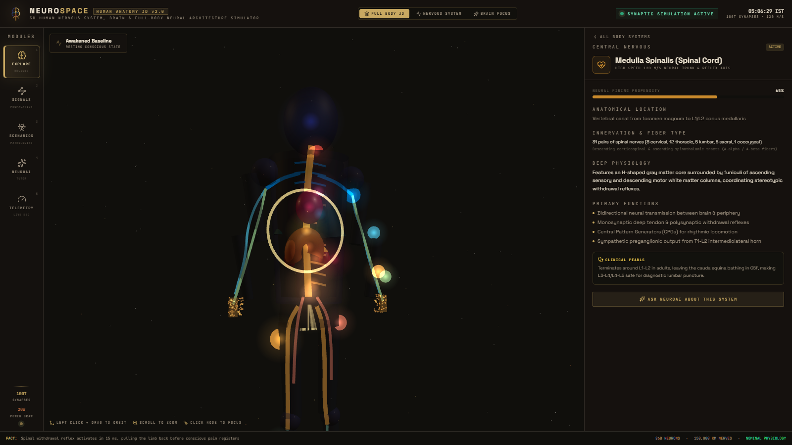
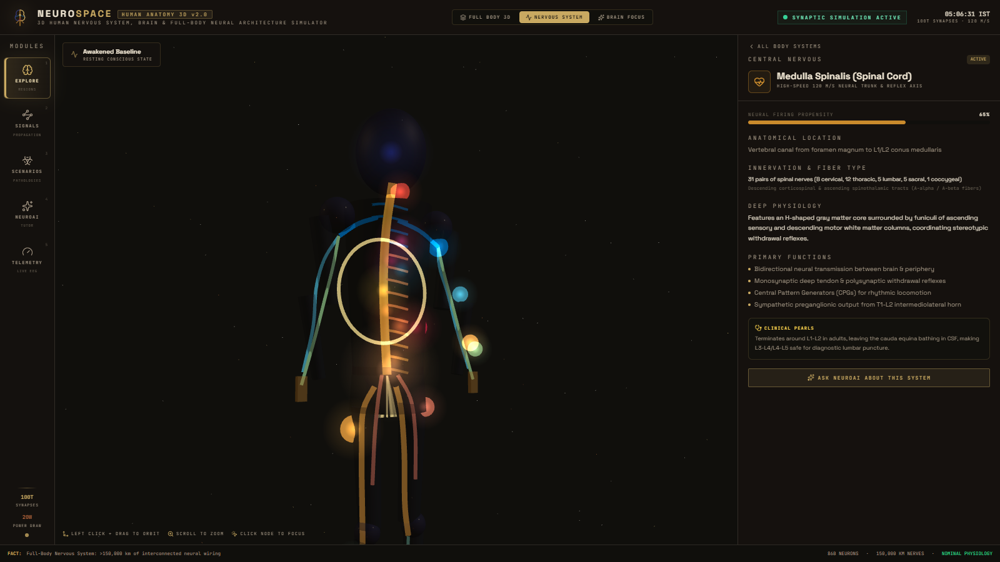
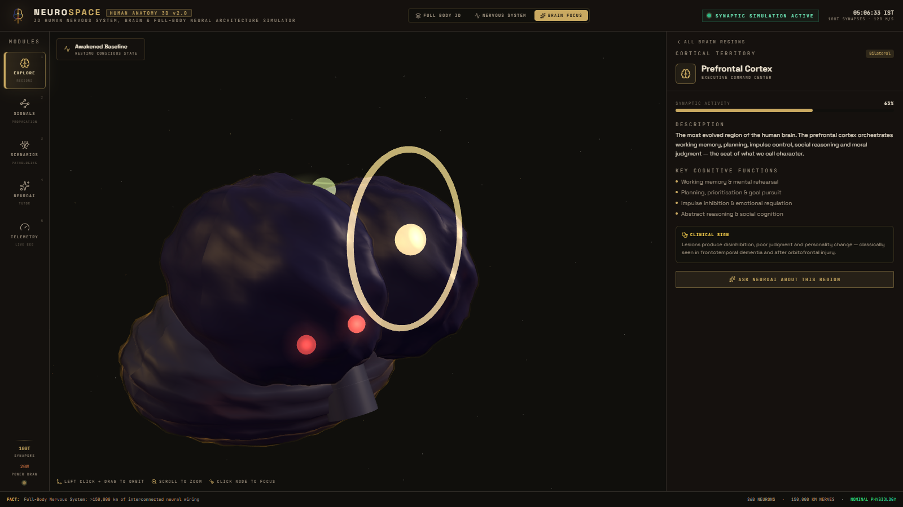
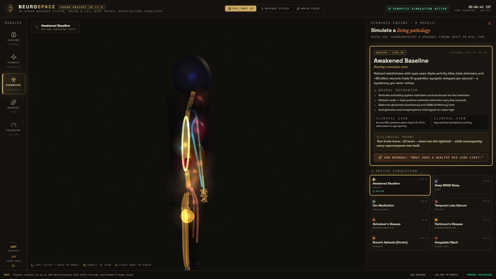
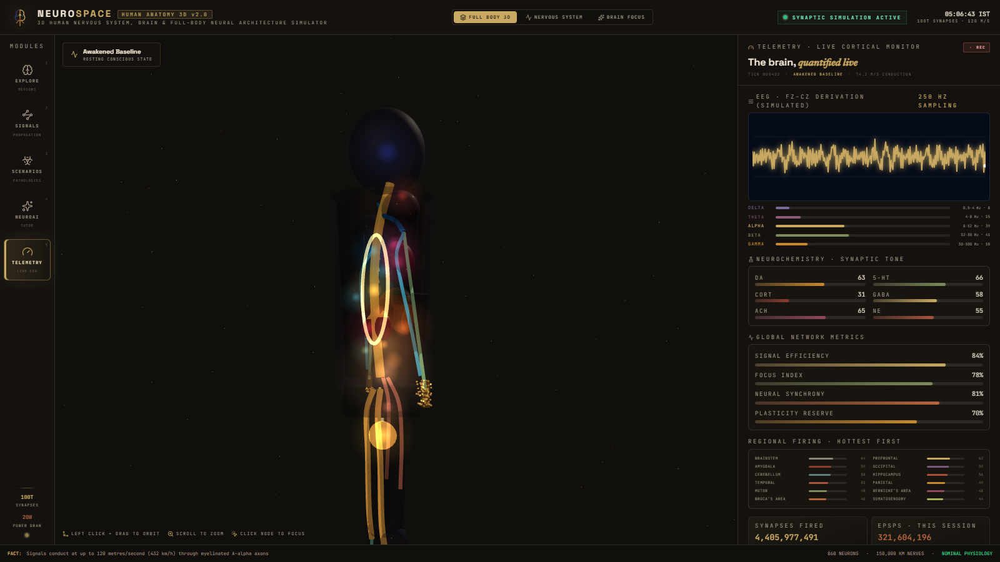

# 🧠 NEUROSPACE — Interactive 3D Human Nervous System, Brain & Full-Body Neural Architecture Simulator

> 📌 **Executive Overview:** **NEUROSPACE** is a high-craft 3D WebGL Virtual Simulator and Medical Neuroscience Engine exploring the complete human neural architecture: the **Central Nervous System (CNS)**, **Cerebrum & 12 Cortical Territories**, **Spinal Cord & Reflex Axis**, **Peripheral Nervous System (PNS & Somatosensory Plexuses)**, **Autonomic Visceral Networks ("Second Brain" & Cardiac Plexus)**, and the **Cutaneous Integumentary Envelope & Segmental Dermatomes (C2–S5)**. Featuring biophysical action potential signal propagation, living neurological pathology simulations, and an on-device **NeuroAI** anatomical tutor.

---

## 📋 Project Metadata Properties

| Property | Value |
| :--- | :--- |
| **Project Title** | NEUROSPACE — 3D Human Nervous System & Anatomical Architecture |
| **Version** | `2.0.0` Production Grade |
| **Workspace Directory** | `L:\pr 30(NEUROSPACE)` |
| **Primary Visual Palette** | **Midnight Indigo & Vanilla** (`#30356F` Midnight Indigo + `#FBF5E6` Vanilla Neutral + `#C9A961` Synaptic Gold + `#802838` Crimson Alert) via `colours for websites` skill |
| **Frontend Stack** | React 19, TypeScript 5.8+, Vite 6, Tailwind CSS v3.4+, Three.js WebGL2 (`three@0.175.0`), Lucide Icons |
| **Scientific Architecture** | Multi-Laminar Cortical Mapping, Hodgkin-Huxley-inspired Action Potential Propagation, Full-Body Plexus Hierarchy, Dermatome Topography (C2–S5), EEG Wavelet Spectrum (Delta to Gamma) |
| **Verified Verification Suite** | Playwright WebGL2 Chromium headless verification (`1600×900`), 0 console errors, 8/8 high-res state screenshots captured |
| **Public GitHub Repository** | [`KARTHIKEYASHARMA672/neurospace`](https://github.com/KARTHIKEYASHARMA672/neurospace) (`main`) |
| **Hosted Production URL** | [https://neurospace-3d.vercel.app](https://neurospace-3d.vercel.app) (HTTP 200 OK via Vercel) |
| **LinkedIn Showcase Schedule** | Day 18 Queue (`automation_tracker.json` & `posts_ready.json`) |

---

## 🖼️ Verified Visual Verification Gallery

> 📸 *All 8 visual artifacts below are verified live screenshots rendered using Playwright WebGL Chromium headless suite (`1600×900`) against the production build.*

| 01 — Full-Body 3D Nervous System Overview | 02 — Peripheral Nervous System & Sciatic Detail |
| :---: | :---: |
|  |  |
| *Full 3D holographic human anatomical scaffold showing central spinal axis, cranial vault, and bilateral brachial/sciatic peripheral nerve trunks.* | *High-resolution inspection of the 2 cm caliber Sciatic Nerve (L4–S3), popliteal bifurcation, and lower limb motor-sensory distribution.* |

| 03 — Visceral & Autonomic Organs ("Second Brain") | 04 — Cutaneous Integumentary & Dermatomes (C2–S5) |
| :---: | :---: |
|  |  |
| *Deep inspection of the Enteric Nervous System (ENS, 500M neurons), cardiac autonomic plexus, pulmonary bronchi, and renal-adrenal axes.* | *Translucent dermal boundary showing tactile mechanoreceptor fields and colored segmental dermatome rings (C2–S5).* |

| 05 — 3D Brain Focus & 12 Cortical Territories | 06 — Signal Propagation: Spinal Reflex Arc |
| :---: | :---: |
|  |  |
| *Dedicated macro view of the cerebral hemispheres with procedural sulci/gyri displacement and 12 glowing functional cortical regions.* | *Real-time action potential conduction: Foot stepping on pin triggering 15 ms polysynaptic spinal reflex + 200 ms spinothalamic pain ascent.* |

| 07 — Neurological Scenarios & Pathology Engine | 08 — Live Telemetry, EEG Power Bands & Neurotransmitters |
| :---: | :---: |
|  |  |
| *8 simulated clinical states (Epilepsy, Alzheimers, Parkinsons, Ischemic Stroke, Acute Stress, NREM Sleep, Zen Meditation).* | *Real-time 60 Hz synthetic EEG waveform monitor, 5 Fourier frequency bands (Delta to Gamma), and 6 core neurotransmitter gauges.* |

---

## 🔬 Core Anatomical Systems & Technical Architecture

### 1. Central Nervous System (CNS) & Brain Regional Atlas
- **12 Cortical & Subcortical Territories:** Prefrontal Cortex, Primary Motor Strip, Somatosensory Cortex, Parietal Association, Occipital Visual Area (V1), Temporal Lobe, Wernicke Area, Broca Center, Hippocampus, Amygdala, Cerebellum (69B neurons), and Medullary Brainstem.
- **Micro-Displaced Procedural Shaders:** Deterministic 4-octave sinusoidal gyri noise sculpting natural anatomical sulcal fissures and longitudinal cerebral cleavage.
- **Bilateral Coordinate Mapping:** Calibrated 3D anchor positions with dynamic normal-oriented surface flares and billboarded internal deep nuclei.

### 2. Peripheral Nervous System (PNS) & Major Nerve Trunks
- **Spinal Cord & Cauda Equina:** 31 pairs of spinal roots with segmental exit vectors (C1–S5), intermediolateral autonomic columns, and descending corticospinal motor tracts.
- **Brachial Plexus Highway (C5–T1):** Roots, trunks, divisions, cords, and terminal branches including the Radial Nerve (extensor compartment & spiral groove) and Median Nerve (carpal tunnel & precision pinch).
- **Lumbosacral Trunk & Lower Limb:** Femoral Nerve (quadriceps & patellar reflex arc), Sciatic Nerve (2 cm caliber main trunk), and Tibial / Peroneal branches governing plantar push-off and dorsiflexion clearance.

### 3. Autonomic Nervous System & Visceral Organs ("Second Brain")
- **Enteric Nervous System (ENS):** 500 million neurons coordinating gastrointestinal peristalsis, secretomotor fluid flux, and synthesizing >90% of bodily serotonin (5-HT).
- **Cardiac Autonomic Plexus:** Dual adrenergic / vagal muscarinic modulation of the sinoatrial pacemaker and ventricular inotropy.
- **Pulmonary & Splanchnic Hubs:** Bronchomotor tone regulation, Hering-Breuer stretch protective reflexes, and celiac plexus sympathetic vasoconstriction.
- **Sympathoadrenal Axis:** Adrenal chromaffin cells discharging epinephrine and norepinephrine for immediate full-body fight-or-flight mobilization.

### 4. Integumentary System & Sensory Mechanoreceptors
- **Cutaneous Sensory Envelope:** 2 m² external tactile boundary featuring A-beta, A-delta, and C-fibers.
- **Tactile Receptor Matrix:** Pacinian corpuscles (high-frequency vibration), Meissner corpuscles (grip slippage), Merkel discs (sustained point pressure), and Ruffini cylinders (skin stretch).
- **Segmental Dermatomes (C2–S5):** Topographic spatial bands encircling the torso and limbs for clinical neurological localization.

---

## ⚡ Biophysical Signal Propagation Cascades

1. **Foot Stepping on Pin (Spinal Reflex & Cortical Pain):** Cutaneous A-delta/C-fibers → Tibial Nerve → L4–S1 Dorsal Horn (15 ms polysynaptic withdrawal reflex) → Spinothalamic Tract → S1 Somatosensory Cortex (200 ms conscious suffering).
2. **Voluntary Precision Reach & Grip:** M1 Motor Cortex → Lateral Corticospinal Tract → C5–T1 Cervical Cord → Brachial Plexus → Radial / Median Nerves → Cutaneous Fingertip Mechanoreceptor feedback at 50 Hz.
3. **Acute Fight-or-Flight Alarm:** Amygdala & Hypothalamus → Thoracolumbar Intermediolateral Horn → Cardiac Plexus (SA node 160 bpm) → Greater Splanchnic Nerve → Adrenal Epinephrine Surge → Splanchnic Vasoconstriction.
4. **Gut-Brain Serotonin Highway:** Enteric Mucosal Transduction → Nodose Ganglion Sensory Vagal Afferents (80%) → Nucleus Tractus Solitarii (NTS) in Brainstem → Limbic Insula & Prefrontal Tuning.

---

## 🛠️ Local Development & Build Execution

```bash
# Clone the repository
git clone https://github.com/KARTHIKEYASHARMA672/neurospace.git
cd neurospace

# Install dependencies
npm install

# Start local interactive dev server
npm run dev

# Run production build and type check
npm run build

# Preview production build locally
npm run preview
```

---

## 🚀 Live Production Deployment

NEUROSPACE is deployed in production on Vercel:
- **Production URL:** [https://neurospace-3d.vercel.app](https://neurospace-3d.vercel.app)
- **Deployment Platform:** Vercel Global Edge Network
- **Build Status:** Verified 0 Errors, HTTP 200 OK
