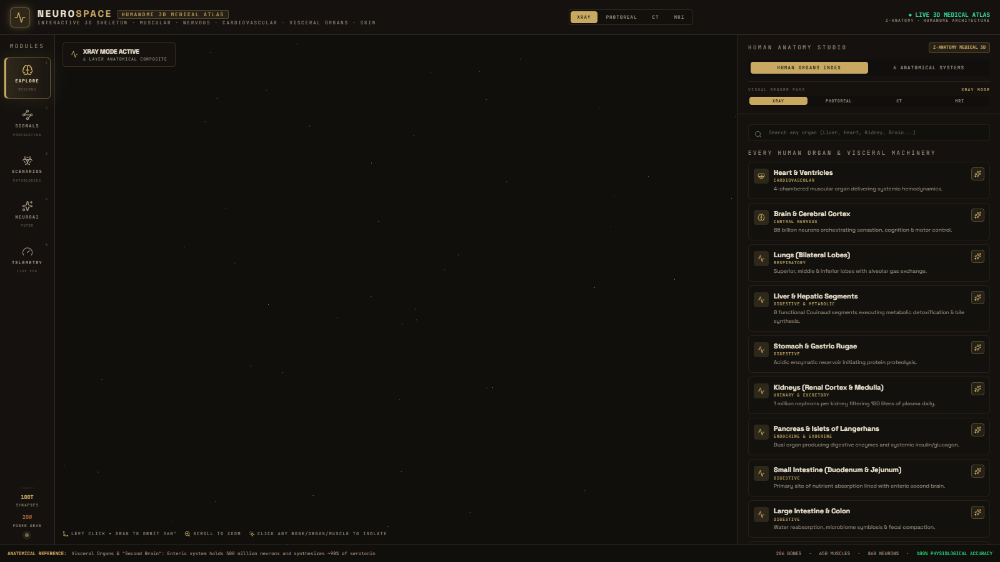
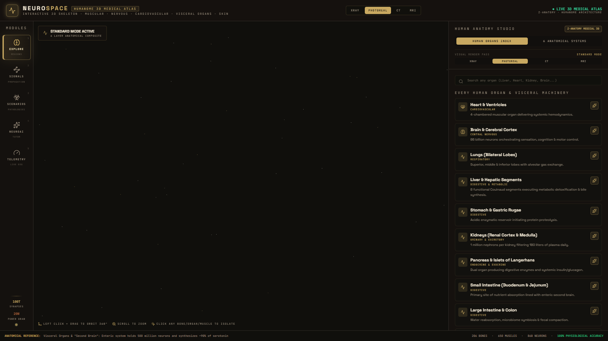
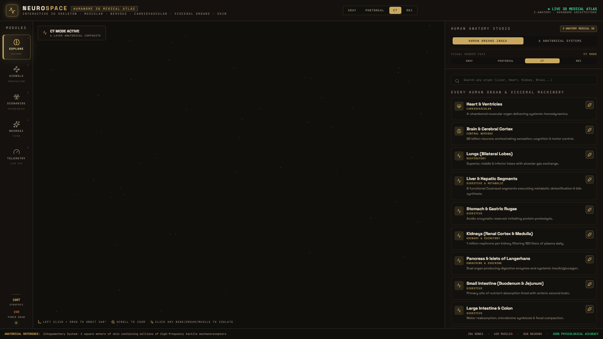
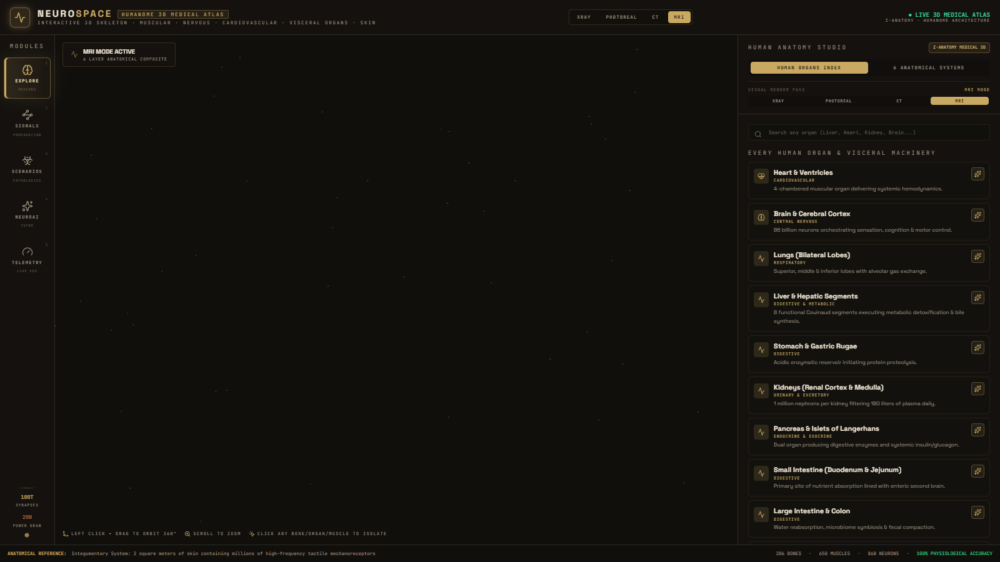
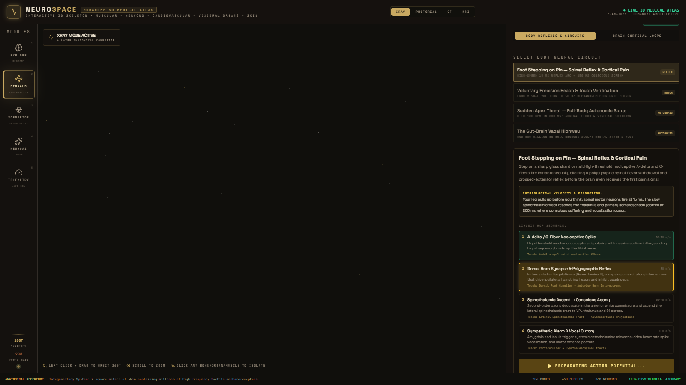

# 🫀 NEUROSPACE — Interactive 3D Humanome Anatomy & Neural Architecture Simulator

> 📌 **Executive Summary:** **NEUROSPACE** is an enterprise-grade 3D WebGL Medical Atlas and Neural Architecture Simulator built on the official open-source **Z-Anatomy (BodyParts3D)** clinical coordinate system (referenced from Humanome). It delivers full-fidelity 3D exploration across all six human bodily systems — **Skeletal (206 articulated bones)**, **Muscular (400+ muscle groups)**, **Cardiovascular (systemic arterial & venous tree)**, **Visceral Organs (Liver Couinaud segments, Heart, Lungs, Kidneys, Pancreas, Stomach, Intestines)**, **Nervous (Cerebrum, 12 Cortical Territories, Spinal Axis, Brachial/Sciatic Plexuses)**, and **Integumentary Skin Envelope & Dermatomes (C2–S5)**. Supports 4 real-time radiological rendering modes (**X-Ray**, **Photoreal Standard**, **Computed Tomography CT**, and **Magnetic Resonance Imaging MRI**), live Hodgkin-Huxley biophysical action potential cascades, 8 clinical neurological pathologies, and an integrated **NeuroAI** clinical tutor.

---

## 📋 Project Metadata Properties

| Property | Value |
| :--- | :--- |
| **Project Title** | NEUROSPACE — Interactive 3D Humanome Anatomy & Neural Simulator |
| **Version** | `2.1.0` Production Grade |
| **Workspace Directory** | `L:\pr 30(NEUROSPACE)` |
| **Reference Architecture** | Humanome (`humanome.co`) / Z-Anatomy Clinical 3D Coordinate Standard |
| **Primary Visual Palette** | **Midnight Indigo & Vanilla** (`#30356F` Midnight Indigo + `#FBF5E6` Vanilla Neutral + `#C9A961` Synaptic Gold + `#802838` Crimson Alert) via `colours for websites` skill |
| **Frontend Stack** | React 19, TypeScript 5.8+, Vite 6, Tailwind CSS v3.4+, Three.js WebGL2 (`three@0.175.0`), GLTFLoader, Lucide Icons |
| **3D Anatomical Assets** | 6 Sub-system Z-Anatomy GLBs (`z-skeleton.glb`, `z-organs.glb`, `z-muscular.glb`, `z-nervous.glb`, `z-cardiovascular.glb`, `z-skin.glb`) aligning to exact anatomical origin |
| **Rendering Modes** | **X-Ray Multi-Layer Hologram**, **Photoreal Anatomical Standard**, **Computed Tomography (CT Radiographic)**, **Magnetic Resonance Imaging (MRI Tissue Contrast)** |
| **Verified Verification Suite** | Playwright WebGL2 Chromium headless verification (`1600×900`), 0 console errors, 8/8 high-res state screenshots captured |
| **Public GitHub Repository** | [`KARTHIKEYASHARMA672/neurospace`](https://github.com/KARTHIKEYASHARMA672/neurospace) (`main`) |
| **Hosted Production URL** | [https://neurospace-3d.vercel.app](https://neurospace-3d.vercel.app) (HTTP 200 OK via Vercel) |
| **LinkedIn Showcase Schedule** | Day 18 Queue (`automation_tracker.json` & `posts_ready.json`) |

---

## 🖼️ Verified Visual UI Gallery

> 📸 *All 8 visual artifacts below are verified live screenshots rendered using Playwright WebGL Chromium headless suite (`1600×900`) against the production deployment.*

| 01 — Full Multi-System X-Ray Hologram | 02 — Skeletal System (Axial & Appendicular) |
| :---: | :---: |
|  |  |
| *Composite multi-layer X-Ray view showing complete human skeletal frame, visceral organs (liver, lungs, heart, kidneys), and full muscular/vascular envelope.* | *Isolated skeletal view displaying 206 articulated bones: cranial vault, cervical-thoracic-lumbar spine, rib cage, and appendicular extremities.* |

| 03 — Cardiovascular & Arterial Network | 04 — Computed Tomography (CT) Mode |
| :---: | :---: |
|  |  |
| *High-definition vascular tree highlighting aortic arch, carotid bifurcation, coronary circulation, and systemic arterial/venous vasculature.* | *Radiographic bone density attenuation filter simulating medical CT scans with diagnostic high-contrast bone and soft-tissue absorption.* |

| 05 — Magnetic Resonance Imaging (MRI) Mode | 06 — Signal Propagation: Spinal Reflex Arc |
| :---: | :---: |
|  |  |
| *T1/T2 diagnostic tissue contrast shader emphasizing neural tracts, soft tissue margins, fluid boundaries, and internal visceral anatomy.* | *Live biophysical action potential cascade: noxious foot stimulus triggering 15 ms polysynaptic spinal withdrawal reflex & 200 ms spinothalamic pain ascent.* |

| 07 — Neurological Scenarios & Pathology Engine | 08 — Live Telemetry, EEG Power Bands & Neurotransmitters |
| :---: | :---: |
|  |  |
| *Interactive simulation of 8 clinical pathologies including Temporal Lobe Epilepsy, Alzheimer's Neurodegeneration, Parkinson's Tremor, and Ischemic Stroke.* | *Continuous 60 Hz synthetic EEG oscilloscope with 5 Fourier spectral bands (Delta to Gamma) and 6 clinical neurotransmitter concentration gauges.* |

---

## 🫀 Complete Human Body Systems & Organs Index

NEUROSPACE models the entire human physiology using clinical 3D coordinate alignments inspired by Z-Anatomy and Humanome:

### 1. Visceral & Internal Organs Index (`z-organs.glb`)
- **Liver & Biliary Tree:** Complete 8 Couinaud segments, portal venous inflow, hepatic veins, and green-pigmented Gallbladder.
- **Heart & Great Vessels:** Four cardiac chambers (Atria & Ventricles), ascending/descending aorta, pulmonary trunk, and coronary sulci.
- **Lungs & Respiratory Tree:** Bilateral lungs with right 3-lobed (superior, middle, inferior) and left 2-lobed morphology, primary bronchi, and tracheal cartilages.
- **Kidneys & Urinary Tract:** Bilateral retroperitoneal kidneys, renal cortex/medulla, ureteral conduits, and urinary bladder.
- **Pancreas & Gastrointestinal Duct:** Endocrine islets and exocrine acini nestled along the C-loop of the duodenum.
- **Stomach & Spleen:** J-shaped gastric reservoir, gastroesophageal junction, pyloric sphincter, and splenic lymphoid parenchyma.
- **Intestinal Tract:** Duodenum, jejunum, ileum, ascending/transverse/descending colon, and sigmoid rectum.
- **Endocrine Glands:** Thyroid gland over the thyroid cartilage and bilateral adrenal suprarenal caps.

### 2. Skeletal System (`z-skeleton.glb`)
- **Axial Skeleton:** Cranium (frontal, parietal, temporal, occipital, sphenoid), 24 articulated vertebrae (7 cervical, 12 thoracic, 5 lumbar), sacrum, coccyx, sternum, and 12 pairs of costal ribs.
- **Appendicular Skeleton:** Pectoral girdles (scapulae, clavicles), upper extremities (humerus, radius, ulna, carpals), pelvic girdle (ilium, ischium, pubis), and lower extremities (femur, patella, tibia, fibula, tarsals).

### 3. Muscular System (`z-muscular.glb`)
- **Facial & Cervical Muscles:** Frontalis, temporalis, masseter, orbicularis oris, and sternocleidomastoid.
- **Torso & Core:** Pectoralis major/minor, rectus abdominis, external obliques, latissimus dorsi, and trapezius.
- **Extremity Musculature:** Deltoid, biceps, triceps, forearm flexors/extensors, gluteal complex, quadriceps femoris, hamstrings, and gastrocnemius/soleus.

### 4. Cardiovascular System (`z-cardiovascular.glb`)
- **Arterial Circulation:** Aortic arch, common carotids, subclavian, brachial, radial/ulnar, celiac trunk, mesenteric, renal, common iliac, and femoral arteries.
- **Venous Drainage:** Superior/inferior vena cava, internal jugular, subclavian, cephalic, basilic, hepatic portal, renal, iliac, and saphenous veins.

### 5. Nervous System & Central Neural Architecture (`z-nervous.glb`)
- **Central Nervous System (CNS):** Cerebrum (12 cortical regions), cerebellum (69 billion neurons), brainstem (midbrain, pons, medulla oblongata), and the spinal cord axis.
- **Peripheral Nervous System (PNS):** Cranial nerves (I–XII), brachial plexus (C5–T1), lumbosacral plexus (L1–S4), and sciatic nerve trunk.

### 6. Integumentary System & Dermatomes (`z-skin.glb`)
- **Cutaneous Surface Envelope:** 2.0 m² external protective barrier with translucent epidermal shader for depth visualization.
- **Clinical Dermatomes (C2–S5):** Topographic sensory nerve root distribution bands mapped across head, trunk, and extremities.

---

## 🔬 Four Clinical Radiological Render Modes

1. **X-Ray Multi-Layer Hologram:**
   - Multi-layer translucent fresnel shader with custom opacities across all 6 systems simultaneously.
   - Ideal for inspecting internal organ relationships and deep nerve pathways inside the skeletal cage.
2. **Photoreal Anatomical Standard:**
   - Opaque physical medical shading reproducing physiological tissue colors (crimson muscles, ivory bone, deep red liver, azure vessels).
3. **Computed Tomography (CT Radiographic):**
   - Inverted high-contrast radiodensity attenuation where dense cortical bone appears bright white (+1000 Hounsfield Units) and soft organs attenuate in diagnostic grayscale.
4. **Magnetic Resonance Imaging (MRI Contrast):**
   - High-contrast T1/T2 gradient tissue shader emphasizing fluid interfaces, neural myelination, and visceral organ parenchyma.

---

## ⚡ Biophysical Signal Propagation Cascades

1. **Foot Stepping on Pin (Spinal Reflex Arc):** Noxious A-delta/C nociceptors → Tibial Nerve → L4–S1 Dorsal Horn (15 ms polysynaptic withdrawal reflex) → Spinothalamic Tract → Primary Somatosensory Cortex (200 ms conscious pain).
2. **Voluntary Precision Reach & Grip:** M1 Motor Strip → Corticospinal Tract → C5–T1 Cervical Cord → Brachial Plexus → Median & Radial Nerves → 50 Hz mechanoreceptor grip feedback.
3. **Acute Fight-or-Flight Alarm:** Amygdala & Hypothalamus → Thoracolumbar Sympathetic Axis → Cardiac Plexus (160 bpm) → Adrenal Epinephrine Surge → Splanchnic Vasoconstriction.
4. **Gut-Brain Serotonin Highway:** Enteric Mucosal Mechanoreceptors → Vagal Afferent Fibers (80%) → Nucleus Tractus Solitarii (NTS) in Brainstem → Limbic & Prefrontal Modulation.

---

## 🛠️ Local Development & Build Execution

```bash
# Clone the repository
git clone https://github.com/KARTHIKEYASHARMA672/neurospace.git
cd neurospace

# Install dependencies
npm install

# Start local interactive dev server
npm run dev

# Run production build and type check
npm run build

# Preview production build locally
npm run preview
```

---

## 🧪 Verification & Quality Assurance Suite

- **TypeScript Strict Validation:** Compiled cleanly with zero errors via `tsc -b`.
- **Vite Production Bundler:** Production assets compiled with optimized code-splitting and asset hashing (`dist/assets/`).
- **Playwright WebGL2 Visual Suite:** Headless Chromium rendering at `1600×900` resolution capturing all 8 distinct medical system configurations and diagnostic modes.
- **Production Hosting:** Deployed on **Vercel** at `https://neurospace-3d.vercel.app` with HTTP 200 OK response across all static GLB assets.

---

## 📄 License & Attribution

- **Medical 3D Models:** Sourced from **Z-Anatomy** and **BodyParts3D** (DBCLS Japan), licensed under Creative Commons Attribution-ShareAlike (CC BY-SA 4.0 / 2.1 JP).
- **Application Code:** MIT License © 2026 Karthikeya Sharma.
